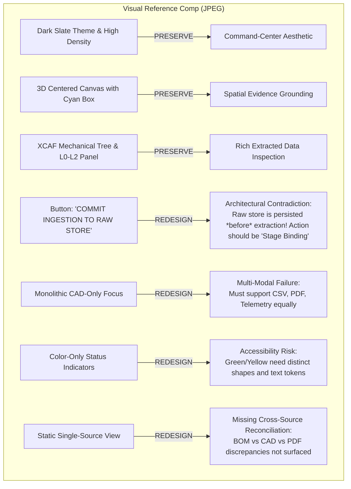

# Ayin Intelligence — Frontend UI Discovery & Architecture Specification

> **Document Type:** Architectural Discovery & UI/UX Design Specification  
> **Status:** Proposal for Product Owner Review  
> **Context:** Ayin Intelligence Frontend Workspace & Operation Housekeeping Backend Alignment  
> **Reference Backend:** [MafasaBytes/operation-house-keeping](https://github.com/MafasaBytes/operation-house-keeping.git)  
> **Reference Visual Comp:** `references/operation_housekeeping_workbench_1795125708407.jpg`  
> **Common Dataset:** `S-01` (BOM CSV), `S-02` (CAD STEP), `S-03` (PDF Manual), `S-04` (Operational Telemetry)

---

## 1. Executive Summary & Purpose of Ayin Intelligence

**Ayin Intelligence** is an engineering system intelligence workbench. Its primary mandate is to help engineers understand complex engineered physical and cyber-physical systems, trace heterogeneous evidence directly to the components and variables it describes, and preserve durable human and practitioner knowledge as systems evolve across lifecycles (`AS_DESIGNED`, `AS_BUILT`, `AS_MAINTAINED`).

In modern engineering organizations, truth is fragmented across disparate silos:
- Engineering BOMs in tabular spreadsheets (CSV)
- Geometry and assembly hierarchies in CAD/CAM definitions (STEP AP214/AP242)
- Service manuals, operating procedures, and diagnostic diagrams in documents (PDF)
- Live runtime sensor streams and operational telemetry (Moonraker / Klipper APIs)
- Abstract system architectures, functional blocks, and state transition graphs (Model Kernel)

Most engineering platforms fail because they make one of two catastrophic errors:
1. **The "Silent Magic" Fallacy:** They perform fuzzy heuristics, automatic auto-linking, or AI guessing in the background without explicit human attribution, creating subtle errors that erode engineering trust.
2. **The "Three-Way Collapse":** They silently conflate **what the raw source reported**, **how an engineer interpreted it**, and **what was accepted into canonical system truth**.

Ayin’s frontend UI must embody the core architectural philosophy accepted across the backend repository (*Operation Housekeeping*):

```text
┌──────────────────────────────────────────────────────────────────────────────┐
│                    THE THREE REALMS THAT NEVER COLLAPSE                      │
├────────────────────────────────┬────────────────────────┬────────────────────┤
│   1. RAW & EXTRACTED EVIDENCE  │  2. IDENTITY BINDING   │   3. MODEL TRUTH   │
│   (What the source reported)   │  (Explicit Decisions)  │ (Accepted Kernel)  │
├────────────────────────────────┼────────────────────────┼────────────────────┤
│ • Write-once raw payloads      │ • Append-only ledger   │ • Typed graph      │
│ • Deterministic SHA-256 hashes │ • 3-valued applicability│ • Canonical UUID   │
│ • Level 0-3 extraction outputs │ • Epistemic badges     │   anchors (ent_/   │
│ • Format locators (row, XCAF,  │ • Adoption tracking    │   var_)            │
│   CropBox, timestamp)          │ • Authority & notes    │ • State & flow     │
│ • Quarantines & diagnostics    │ • Human-gated review   │   definitions      │
└────────────────────────────────┴────────────────────────┴────────────────────┘
```

The frontend UI is not a decorative dashboard; it is a **high-density, mission-critical engineering cockpit** where every pixel serves cognitive clarity, epistemic honesty, and flawless provenance traceability.

---

## 2. Deep Backend Alignment: Mapping UI to Operation Housekeeping

To deliver an authentic, seamless engineering experience, every panel, badge, and interaction in the Ayin frontend must correspond directly to validated backend contracts in `operation-house-keeping`:

| Backend Package / Subsystem | Backend Contract & Architectural Law | Frontend UI Expression in Ayin |
| :--- | :--- | :--- |
| **`data_sources/`** (ADR-0001, 0002, 0003, 0004) | Immutable, write-once filesystem store (`raw_store/`). Payloads persisted *before* extraction. Connector status ladder: `declared → available → configured → connected → validated`. | **Ingestion & Status Rail:** Visual 5-step status ladder. Raw payload inspectability button. Ingestion metadata showing file size, mtime, and deterministic SHA-256 hash. |
| **`data_sources/extractors`** (OCP STEP, PDFium, CSV) | Extraction level ladder (L0 metadata, L1 syntax, L2 structure, L3 3D mesh derivative, L4 semantics). Quarantines are `QuarantineRecord`s, never silent repairs. | **Multi-Modal Evidence Canvas:** Level badges (`LEVEL 3 VALIDATED`). When parsing fails (e.g. PDF password, bad STEP), displays a distinct quarantined diagnostic sheet with redacted error traces, never empty screens. |
| **`system_identity/`** (ADR-0006) | Opaque UUID-backed anchors (`ent_...`, `var_...`). Namespace, display name, and role name are separate. 4 referent kinds: `physical_instance`, `logical_instance`, `type_definition`, `unknown`. | **Canonical Identity Badges:** Crisp monospace tags showing anchor IDs (`ent_heater_block_01`), human display names, and referent kind icons. |
| **`identity_binding/`** (ADR-0006, IB-001) | Append-only ledger of human assertions. Three-valued applicability (`IN`, `OUT`, `UNKNOWN`) over half-open `[start, end)` ingestion intervals. 8 non-overlapping resolution cases (`bound`, `unresolved`, `conflicted`, `applicability_unknown`). | **Binding Ledger Inspector:** Explicit status tags (`Bound`, `Unresolved`, `Conflicted`). Epistemic badges (`[VERIFIED]`, `[SAMPLE]`, `[REPUTED]`). Adoption state (`DERIVED_NOT_ADOPTED` vs `ADOPTED`). "Stage Binding Assertion" action drawer. |
| **`structural_evidence/`** (ADR-0010, SN-001) | `StructuralAddress` pinning evidence. `sx1` subject identity rules. Cross-source reconciliation findings (`corroborated_by_all_mapped_sources`, `quantity_not_reconcilable_with_registered_instances`, `duplicate_source_label_not_identity`, `derived_usage_path_ambiguous`). | **Reconciliation Drawer / Finding Matrix:** Cross-modal comparison card highlighting discrepancies between BOM counts and CAD instances, unmapped subjects, and duplicate source labels. |
| **`temporal_state/` & `model_state/`** (ADR-0005, 0008) | SQLite projection over immutable sources. Facade queries resolving observation at its own `received_at`. | **Temporal Horizon & Clock Filter:** Ability to view system state as of specific historical ingestion revisions (`load_revision`) or inspect time-series telemetry. |

---

## 3. Critique of the Reference Visual Comp (`references/operation_housekeeping_workbench_1795125708407.jpg`)

The visual reference supplied to the workspace provides an invaluable starting point. However, analyzing it against the backend contracts reveals both **high-value design patterns to retain** and **critical structural flaws to redesign**:



### 3.1 Elements to Preserve & Elevate
1. **The Tactical Dark Aesthetic:** Deep slate background (`#0b0f14` to `#111822`), crisp hairline borders (`#263545`), and high data density. Engineers working in industrial, robotics, or complex systems require an interface that minimizes eye strain and maximizes information bandwidth.
2. **The Spatial Anchoring in Central Canvas:** Centering the 3D representation with an interactive mechanical assembly tree on the left and extracted physical properties (Bounding Box, Volume, Centroid) on the right creates an immediate, intuitive spatial mental model.
3. **The Persistent Context Header:** Header chips showing Model ID (`mrv_b8f03e1c`), Extractor (`cadquery-ocp 7.9.3`), Status (`LEVEL 3 VALIDATED`), and Lifecycle Phase (`AS_DESIGNED`).
4. **Copyable Raw Record ID Bar:** The persistent bottom bar displaying `acc5f289912...` with a quick copy action reinforces that everything on screen is rooted in an immutable, content-hashed raw record.

### 3.2 Critical Redesigns Required
1. **Redesigning the Primary Bottom Action:**
   - *Comp Defect:* The button says `COMMIT INGESTION TO RAW STORE`.
   - *Backend Reality:* In `operation-house-keeping`, the Ingestion Runner *already* wrote the raw payload to the disk store before the extractor ever started! An engineer sitting in this workbench is not "committing raw ingestion"; they are reviewing extraction output, asserting identity bindings to canonical components, or resolving quarantine exceptions.
   - *Correction:* Replace this CTA with context-aware actions: `STAGE BINDING ASSERTION`, `REVIEW QUARANTINE`, or `EXPORT RECONCILIATION FINDINGS`.
2. **Supporting Multi-Modal Evidence (Beyond CAD):**
   - *Comp Defect:* The comp only contemplates a 3D STEP viewer.
   - *Backend Reality:* In the shared brief and showcase dataset, Ayin handles CSV BOMs (`S-01`), STEP 3D models (`S-02`), PDF Service Manuals (`S-03`), and Telemetry (`S-04`).
   - *Correction:* The central evidence canvas must be a **Polymorphic Canvas Engine** that seamlessly transitions between:
     - 3D WebGL / glTF mesh canvas (with turntable orbit and bounding box overlays).
     - High-density tabular record sheet for CSV (with row/column coordinate badges).
     - High-fidelity vector/page canvas for PDF (with CropBox locators and quarantine diagnostics).
     - Time-series waveform canvas for operational telemetry (with acquisition clock vs mtime markers).
3. **Epistemic Badging & Non-Color-Dependent States:**
   - *Comp Defect:* Statuses rely heavily on green vs yellow vs red pill fills.
   - *Correction:* Conform to WCAG AAA and Impeccable accessibility standards. Every status must feature a distinct textual badge, an icon, and shape differentiation (e.g. `[BOUND]` with solid outline, `[UNRESOLVED]` with warning triangle and dotted border, `[QUARANTINED]` with alert hexagon).
4. **Surfacing Cross-Source Structural Reconciliation:**
   - *Comp Defect:* No way to see how this STEP file compares with the BOM!
   - *Correction:* Introduce a dedicated **Reconciliation Findings Drawer** that alerts the engineer when the BOM specifies 4 extruder units but the CAD model only shows 1 instance, or when a part has duplicate labels.

---

## 4. The 5-Zone UI Layout Architecture

The Ayin Intelligence Workbench is organized into five coordinated ergonomic zones:

```text
┌────────────────────────────────────────────────────────────────────────────────────────────────────────┐
│ ZONE 1: GLOBAL CONTEXT & SYSTEM RUNTIME HEADER                                                        │
│ Ayin Intelligence // Sources Workbench │ Model: mrv_b8f03e1c │ Status: Level 3 Validated │ AS_DESIGNED │
├──────────────────────────┬──────────────────────────────────────────────┬──────────────────────────────┤
│ ZONE 2: NAVIGATION RAIL  │ ZONE 3: MULTI-MODAL EVIDENCE CANVAS          │ ZONE 4: INSPECTOR PANE       │
│ • Source Catalog         │                                              │ • Extracted Properties       │
│   - S-01 BOM (CSV)       │ [3D WebGL Mesh / Tabular Data Sheet /        │   (L0-L2 metrics, bbox)      │
│   - S-02 STEP (CAD)  [*] │  Document Vector Canvas / Telemetry Waveform]│ • Identity Binding Ledger    │
│   - S-03 Manual (PDF)    │                                              │   (Anchor ID, 3-valued state)│
│   - S-04 Stream (API)    │ Interactive 3D Toolhead Assembly             │ • Epistemic Badges           │
│ • Source Hierarchy Tree  │ [ Cyan Bounding Box on Hotend_Heater_Block ] │   ([VERIFIED], [SAMPLE])     │
│   v Assembly_Root        │                                              │ • Adoption State             │
│     > Frame_Subassembly  │ Part 21 Units: mm (Declared)                 │   (DERIVED_NOT_ADOPTED)      │
│     v Toolhead_Mount     │ Extractor: cadquery-ocp 7.9.3                │ • Reconciliation Findings    │
│       Stepper_Extruder   │                                              │   (Quantity mismatch alert)  │
│       Hotend_Heater_Block│                                              │                              │
├──────────────────────────┴──────────────────────────────────────────────┴──────────────────────────────┤
│ ZONE 5: AUDIT, PROVENANCE & DECISION FOOTER                                                            │
│ Raw Record ID: acc5f289912d... [Copy] │ Write-Once Store: IMMUTABLE │ Actions: [Stage Binding Assertion]│
└────────────────────────────────────────────────────────────────────────────────────────────────────────┘
```

### Zone 1: Global Context & System Runtime Header
- **Product Wordmark:** `Ayin Intelligence` with subtle version badge (`v0.4.2-alpha`).
- **Surface Mode Indicator:** `// SOURCES WORKBENCH`.
- **System Anchor Chip:** Active target model kernel identifier (e.g. `MODEL: mrv_b8f03e1c` or `MACHINE: Voron-V2.4`).
- **Extractor Engine Fingerprint:** Pinned toolchain version badge (e.g. `cadquery-ocp 7.9.3` or `pdfplumber 0.11.0`).
- **Overall Ingestion Status Pill:** `LEVEL 3 VALIDATED` (with green status bead).
- **Engineering Lifecycle Phase:** Segmented control indicating context (`AS_DESIGNED`, `AS_BUILT`, `AS_MAINTAINED`).

### Zone 2: Navigation & Ingestion Rail (Left Pane)
- **Source Catalog Card:**
  - Lists ingested source records (`S-01` through `S-04`).
  - Displays source type icons (Lucide `table-2`, `box`, `file-text`, `activity`).
  - Real-time **Connector Pipeline Ladder** for each item:
    `declared → available → configured → connected → validated`
- **Source Hierarchy Tree (Context-Aware):**
  - For CAD (`S-02`): XCAF Part 21 mechanical assembly tree (`Assembly_Root` → `Frame_Subassembly`, `Toolhead_Mount` → `Hotend_Heater_Block`).
  - For BOM (`S-01`): Parent-child containment tree (`PRN-000` → `EXT-100` → `FAS-500`).
  - For PDF (`S-03`): Document structure & page navigator with quarantine badge.
  - For Telemetry (`S-04`): Channel & sensor list (extruder temp, bed temp, fan speed).

### Zone 3: Multi-Modal Evidence Canvas (Center Viewport)
The hero surface of Ayin. It adapts instantly to the selected source modality while maintaining a constant coordinate framework and dark workbench grid background (`linear-gradient` 24px grid).
- **CAD Mode:** Interactive 3D WebGL canvas. Supports orbit, pan, zoom, wireframe toggle, unit display (mm vs m), exploded subassembly view, and highlights the selected node in neon cyan with a 3D bounding box overlay.
- **BOM Mode:** High-density virtualized data table. Displays index rows, part numbers, descriptions, quantities, and cell locators (`CSV · Row 12`).
- **PDF Mode:** Document canvas with CropBox coordinate indicators, page-level text blocks, vector diagnostics, and quarantine error banners.
- **Telemetry Mode:** High-frequency waveform timeline with synchronized hover scrubbers and observation timestamps (`received_at`).

### Zone 4: Inspector & Epistemic Ledger (Right Pane)
Separated into logical, stacked sub-panels:
- **Panel A — Extracted Properties (L0–L2):**
  - Dimensions / Bounding Box (e.g. `220 x 220 x 250 mm`)
  - Volume (`14,230 mm³`), Surface Area, Centroid coordinates (`[110, 110, 12.5]`)
  - PMI / GD&T tokens callout (e.g. `14 tokens detected (uninterpreted)`)
- **Panel B — Identity Binding Ledger (IB-001):**
  - Source Subject reference (`Hotend_Heater_Block` or `CSV · Row 12`)
  - Target Canonical Anchor (`ent_heater_block_01` / `var_hotend_temp`)
  - Three-valued applicability status (`Bound`, `Unresolved`, `Conflicted`, `Applicability_Unknown`)
  - Epistemic Badges (`[VERIFIED]`, `[SAMPLE]`, `[REPUTED]`, `[CONTESTED]`)
  - Adoption status (`DERIVED_NOT_ADOPTED` vs `ADOPTED`)
  - Staged assertion button (`Stage Binding Assertion...`)
- **Panel C — Cross-Source Reconciliation Matrix (SN-001):**
  - Corroboration summary across all mapped sources
  - Discrepancy warnings (e.g. `BOM quantity (4) ≠ Model instances (1)`)

### Zone 5: Audit, Provenance & Decision Footer (Bottom Bar)
- **Raw Record ID Tag:** Full SHA-256 or truncated hex with 1-click clipboard copy (`acc5f289912d...`).
- **Payload Integrity Status:** `Write-Once Store: VERIFIED SHA-256`.
- **Active Timestamp:** `captured_at` (acquisition clock) vs `source_mtime`.
- **Primary Operational Actions:**
  - `Inspect Raw Store Envelope`
  - `Quarantine Diagnostic Review`
  - `Stage Binding Assertion`

---

## 5. Concrete Evaluation Against the 4 Common Benchmark Tasks

The shared workspace specification defines four common records (`S-01` to `S-04`) and three common engineering evaluation tasks. Here is exactly how the Ayin UI enables an engineer to complete each task effortlessly:

```text
┌────────────────────────────────────────────────────────────────────────────────────────┐
│                        COMMON BENCHMARK EVIDENCE EVALUATION                            │
├────────┬──────────────────────┬──────────────────────┬─────────────────────────────────┤
│ Record │ Modality & Status    │ Raw Retention        │ Extraction Outcome              │
├────────┼──────────────────────┼──────────────────────┼─────────────────────────────────┤
│ S-01   │ Assembly BOM (CSV)   │ Retained as R-01     │ Succeeded. Row 12 is bracket.   │
│ S-02   │ Assembly CAD (STEP)  │ Retained as R-02     │ Partial. 3D derivative missing. │
│ S-03   │ Service Manual (PDF) │ Retained as R-03     │ Quarantined (Parse error).      │
│ S-04   │ Telemetry (API)      │ No payload captured  │ Failed acquisition attempt.     │
└────────┴──────────────────────┴──────────────────────┴─────────────────────────────────┘
```

### Task 1: Find `S-01`, open the extracted BOM row, and identify raw record, locator, and linked component
- **User Action in UI:** Engineer clicks `S-01` in the Source Catalog.
- **UI Response:**
  - The central canvas switches to the **Tabular Extracted Record Sheet**.
  - Row 12 (`Mounting bracket`, `BRK-400`) is clearly visible with an accent indicator.
  - Clicking Row 12 highlights the locator badge `CSV · Row 12`.
  - The right Inspector displays the linked canonical component: `Component C-01` (`ent_mounting_bracket_01`) with badge `[SAMPLE BINDING]`.
  - The footer displays the raw record ID `R-01` (`acc5f289912...`) with an "Open Raw Record" button that inspects the write-once CSV envelope.

### Task 2: Open `S-02`, find assembly evidence, and explain missing preview and unresolved binding
- **User Action in UI:** Engineer clicks `S-02` in the Source Catalog.
- **UI Response:**
  - Central canvas displays the **Assembly Evidence Sheet** with an explicit notice:  
    `3D Derivative Unavailable: Extractor produced Level 0-2 structural manifest only.`
  - The left hierarchy shows the assembly occurrence node: `Mounting bracket` under `Toolhead_Mount`.
  - The right Inspector explains the unresolved binding:
    - Status: `[UNRESOLVED]` (amber badge with warning icon).
    - Explanation: `"Similar label detected ('Mounting bracket'), but no explicit BindingAssertion exists in the ledger. Human decision required."`
  - The engineer immediately understands that this is an *honest partial extraction* where structural containment is known, but the glTF mesh failed or was skipped, and no binding has been asserted.

### Task 3: Compare `S-03` and `S-04` — raw payload inspectability and failure boundaries
- **User Action in UI:** Engineer inspects `S-03`, then selects `S-04`.
- **UI Response:**
  - **For `S-03` (PDF):**
    - Pipeline status shows `[QUARANTINED]`.
    - Central canvas displays a **Parse Diagnostic Card**:  
      `Quarantined: EXTRACT_PDF_PASSWORD_REQUIRED. Extraction stopped before Phase B.`
    - Crucially, the UI indicates: `Raw Payload: R-03 (Retained & Inspectable)`. The engineer can click `Inspect Raw Payload` to download or audit the exact original PDF bytes.
  - **For `S-04` (Operational Snapshot):**
    - Pipeline ladder shows failure at the acquisition rung: `declared → available → configured → [FAILED ACQUISITION]`.
    - Central canvas displays: `Acquisition Failed: Connection refused on endpoint http://moonraker.local:7125/printer/objects/query`.
    - Crucially, the UI indicates: `Raw Payload: None captured. Extraction did not run.`
  - **Comparison Clarity:** The engineer immediately perceives that `S-03` reached the store and preserved raw evidence despite an extractor crash, whereas `S-04` failed at the connector boundary and left zero bytes in the raw store.

---

## 6. Design System Tokens & Aesthetic Foundations

In accordance with the `frontend-GOD` and `impeccable` skill instructions, Ayin implements an **Operate-mode design system** emphasizing scanability, mathematical precision, and zero visual gimmicks.

### 6.1 Semantic Color Tokens
```css
:root {
  /* Chrome & Structural Surfaces */
  --aw-color-void:        #080c10;  /* Deepest viewport canvas */
  --aw-color-chrome:      #0e141b;  /* Outer application shell */
  --aw-color-panel:       #121922;  /* Base card & inspector panels */
  --aw-color-raised:      #182330;  /* Elevated controls, hovered lists */
  --aw-color-hover:       #1f2e3f;  /* Interactive hover state */
  --aw-color-border:      #263545;  /* Crisp structural dividers */
  --aw-color-border-sub:  #1b2733;  /* Subdued secondary lines */

  /* Typography & Readability */
  --aw-color-text-bright: #f0f4f8;  /* Primary headings, active values */
  --aw-color-text-main:   #d2dce6;  /* Standard reading body text */
  --aw-color-text-muted:  #8b9cae;  /* Secondary facts, labels, locators */
  --aw-color-text-faint:  #5c6e80;  /* Disabled, placeholders, hashes */

  /* Epistemic & Operational Accents */
  --aw-accent-cyan:       #44c7d4;  /* Active selection, 3D highlights */
  --aw-accent-cyan-glow:  rgba(68, 199, 212, 0.15);
  --aw-status-bound:      #34d399;  /* Validated, bound, corroborated */
  --aw-status-bound-bg:   rgba(52, 211, 153, 0.12);
  --aw-status-warn:       #f59e0b;  /* Unresolved, partial, mismatch */
  --aw-status-warn-bg:    rgba(245, 158, 11, 0.12);
  --aw-status-alert:      #ef4444;  /* Quarantined, failed, conflicted */
  --aw-status-alert-bg:   rgba(239, 68, 68, 0.14);
}
```

### 6.2 Typography Rationale
- **Primary UI & Headings:** `Inter` / `Ayin Inter` — Neutral, unopinionated grotesk sans-serif with tall x-height and exceptional rendering at small sizes (11px–13px).
- **Data, Coordinates, Identifiers & Locators:** `JetBrains Mono` / `Ayin JetBrains Mono` — Monospaced font with slashed zero (`0`), tabular numerals, and distinct glyph differentiation (`1`, `l`, `I`, `0`, `O`) essential for verifying SHA-256 hashes, CAD vector coordinates, and matrix tokens.

---

## 7. Deliverables & Next Steps

Under `discovery/`, we have established:
1. `discovery/FRONTEND_UI_DISCOVERY.md` *(This Document)* — The definitive architecture specification and critique.
2. `discovery/ayin-evidence-workbench.html` — A fully interactive, high-fidelity standalone prototype implementing the 5-zone workbench, multi-modal canvas switching, live 3D toolhead rendering, and the 4 common benchmark tasks.
3. `discovery/README.md` — Discovery guide for team and Product Owner walkthrough.
